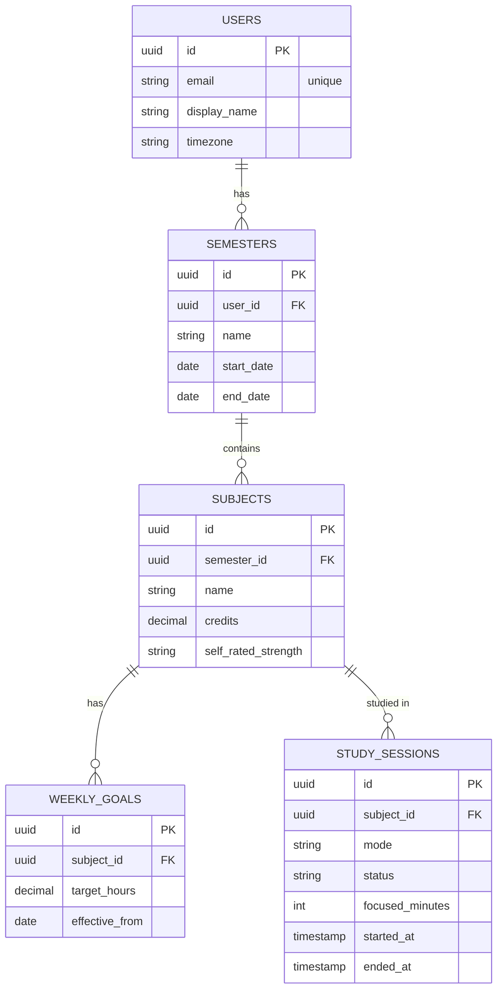

# Focus Dashboard

I'm a CS student with ADHD, and staying focused and knowing where my time actually goes has always been a challenge. Most study apps either track time or track grades, but none of them connect the two, so you never find out whether the hours you put into Physics are actually paying off. Focus Dashboard is the tool I wanted for myself: you set weekly study goals for each class, run focused study sessions, and see how your logged hours stack up against those goals. Grades, GPA, and a desktop agent that keeps you off Discord are next.

I'm also using it to learn full-stack development the slow way, writing and understanding every line instead of generating it.

## Where it's at

The backend core is done and tested. You can create a user, add semesters and classes, set weekly goals, start and end study sessions, and ask for a weekly progress report like "Physics: 4.5 of 7 hours this week." The frontend and the rest of the features are on the [roadmap](#roadmap).

## How it's built

The backend is Java 17 and Spring Boot on top of PostgreSQL, with JPA/Hibernate handling the database mapping. It follows a standard layered design: controllers deal with HTTP, services hold the business rules, and repositories talk to the database. Every endpoint takes and returns small request/response records rather than database entities, so the API stays clean and clients can't set fields they shouldn't. The frontend will be Next.js with TypeScript, and the desktop agent will be C++.

I wrote up the reasoning behind every major choice in [docs/decisions.md](docs/decisions.md).

## A few parts I'm proud of

**Weeks follow your timezone, not the server's.** If you study until 11:30 PM on a Sunday in New York, it's already Monday in UTC. A naive version would count that session toward the wrong week. The progress report works out week boundaries in your own timezone, and there's a test that freezes the clock at exactly that Sunday-night moment to prove it.

**Goals keep their history.** Changing your Physics goal from 7 to 10 hours doesn't overwrite the old one. It adds a new goal with the date it takes effect, so later features can compare how goals changed against how grades moved.

**Study sessions have rules.** The server decides when a session started and ended and how long it lasted, not the client. You can only have one session running at a time, and trying to start a second one returns a clear 409 Conflict instead of corrupting your data.

**GPA stays accurate mid-semester.** Your current grade only counts the categories that have grades so far, so if the final is worth 50% and hasn't happened yet, you're not graded as if you scored zero on it.

**Errors mean something.** Bad input gets a 400 with a message about which field was wrong, missing things get a 404, and conflicts get a 409. A 500 only ever means a real bug.

## Data model



## API

| Method | Endpoint | What it does |
|---|---|---|
| POST | `/users` | Create a user |
| GET / PATCH / DELETE | `/users/{id}` | Get, update, or delete a user |
| POST / GET | `/users/{userId}/semesters` | Add or list a user's semesters |
| GET / PATCH / DELETE | `/semesters/{id}` | Get, update, or delete a semester |
| POST / GET | `/semesters/{semesterId}/subjects` | Add or list a semester's classes |
| GET / PATCH / DELETE | `/subjects/{id}` | Get, update, or delete a class |
| POST / GET | `/subjects/{subjectId}/weekly-goals` | Set a new goal or see goal history |
| POST / GET | `/subjects/{subjectId}/study-sessions` | Start a session or list past ones |
| PATCH | `/study-sessions/{id}/end` | End a running session |
| GET | `/users/{userId}/progress/weekly` | This week's hours vs. goals, per class |
| GET | `/users/{userId}/grade-cutoffs` | See your grade scale |
| PATCH | `/grade-cutoffs/{id}` | Change a letter's cutoff or grade points |
| POST / GET | `/subjects/{subjectId}/grade-components` | Add or list a class's weighted grade categories |
| GET / PATCH / DELETE | `/grade-components/{id}` | Get, update, or delete a grade category |
| POST / GET | `/grade-components/{componentId}/grade-entries` | Add or list graded work in a category |
| GET / PATCH / DELETE | `/grade-entries/{id}` | Get, update, or delete a graded item |
| GET | `/subjects/{subjectId}/grade` | A class's current percent and letter, with a per-category breakdown |
| GET | `/semesters/{semesterId}/gpa` | A semester's GPA |
| GET | `/users/{userId}/gpa` | Cumulative GPA, including prior history |

## Running it locally

You'll need Java 17+ and PostgreSQL.

```bash
createdb focus_dashboard
cd backend
./mvnw spring-boot:run
```

Before starting, set `spring.datasource.username` in `backend/src/main/resources/application.properties` to your Postgres user. The API runs on `http://localhost:8080`, and the tables are created on first start.

To run the tests:

```bash
cd backend
./mvnw test
```

## Roadmap

- [x] Core backend: users, semesters, classes, goals, study sessions, weekly progress
- [x] Grades and GPA, with weighted grade categories and live semester and cumulative GPA
- [ ] Login with Spring Security and JWT, plus Flyway database migrations
- [ ] A free-time calculator and quick check-ins after each session
- [ ] The Next.js frontend
- [ ] Deployment
- [ ] A desktop agent that tracks and blocks distracting apps during sessions
- [ ] Study-time suggestions based on how your hours and grades line up
